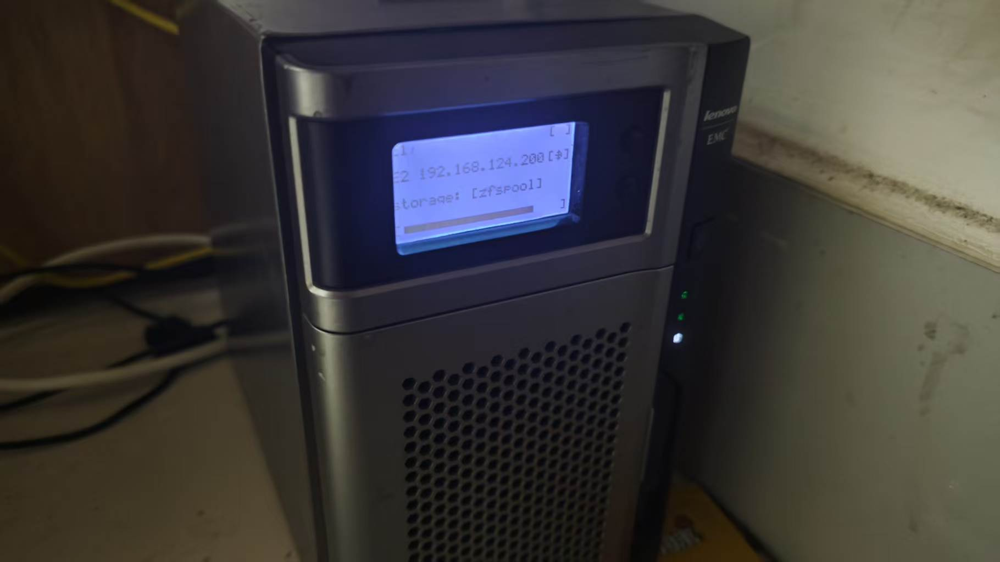

# px2-300d LCD

LenovoEMC px2-300d 前面板 **128×64 单色 LCD（含背光、Select / Scroll 按键）**
的现代 Linux 驱动与 Python 操作层。

原厂 LifeLine 固件只提供绑定 2013 年内核（Linux 3.2/3.8）的整套平台补丁，
用户态显示程序闭源。本项目把前面板相关逻辑从原厂补丁中剥离、重写为一个
**可在现代内核上动态加载（insmod）的独立内核模块**，并配套零第三方依赖的
Python 库与示例程序，可直接驱动屏幕、背光和两个按键。

> 已在 Debian13 上完成模块编译，硬件寄存器时序与
> 原厂驱动逐行一致。
## 前面板状态：

> sudo python3 workspace/lcm_user/screens/screen_ip_storage.py



## 功能特性

- **128×64 单色 LCM**：整屏 / 按页写入、任意点阵内容（ST7565 兼容控制器）
- **LCD 背光**：亮 / 灭 / 硬件闪烁三态，支持 sysfs、标准 backlight class 与 ioctl
- **两个前面板按键**：Select、Scroll，内核 20ms 轮询 PCH GPIO 电平并软件去抖
  （避免 ACPI GPE 电平中断被风暴保护永久关闭），支持阻塞/非阻塞读取、
  `poll` 与 Python 回调
- **动态加载**：单个 `.ko`，无需重编内核；在非 px2-300d 机器上会安全拒绝加载
- **Python 接口层**：硬件能力与业务操作分离，内置 5×7 点阵字库与帧缓存
- **节能状态屏示例**：IP / ZFS 容量显示、相同帧不刷新、10 秒无变化自动关背光、
  按任意键唤醒（提供 Python 与 C 两个等价实现）
- 仅依赖 Linux 内核头文件与 Python 标准库（Python 2.7 / 3 通用库接口） 

## 硬件说明

屏幕不是 USB / I2C 设备，而是挂在主板 **Nuvoton NCT6776F 超级 I/O 芯片**上：

- 显示数据通过 Super-I/O GPIO **软件模拟 8080 并行总线**传输；
- 背光走 NCT6776F 的 AUXFANOUT（PWM）引脚；
- Select / Scroll 按键接 Intel ICH8 PCH GPIO2/GPIO3，由驱动轮询电平（不走 ACPI GPE）。

完整的引脚映射、寄存器地址、ioctl ABI、初始化时序、背光复用前提等**技术细节**
请参阅调研文档：[readfile/work.md](readfile/work.md)。

## 目录结构

```
px2_300d_lcd/
├── README.md                     本文件
├── readfile/
│   ├── work.md                   ★ 原厂补丁逆向调研（全部技术细节，建议先读）
|   ├── ShowImage/
│   │   └── jpeg1.jpg             实拍前面板效果
│   ├── b2a.patch                 LenovoEMC 官方开源套件中的原始内核补丁
|   └── display.pptx              前面板显示内容的需求稿（把ppt转成png发给ai让帮忙完成）
│
└── workspace/
    ├── lcm_driver/               独立可加载内核模块
    │   ├── wixlcm.c              驱动主体（LCD + 背光 + 按键，单文件）
    │   ├── lcm_uapi.h            内核/用户态共用接口定义
    │   ├── Makefile              树外 Kbuild
    │   ├── load.sh               编译 + insmod 一键脚本
    │   └── unload.sh             rmmod 卸载脚本
    │
    └── lcm_user/
        ├── px2lcm.py                           通用硬件接口层（唯一操作 /dev/lcm 的模块）
        ├── examples/                           基础与回调示例
        │   ├── demo_on.py / demo_off.py        开屏 / 关屏
        │   ├── demo_white.py / demo_black.py   全亮 / 全黑
        │   ├── demo_stripe.py                  间隔 1 亮 1 黑
        │   └── demo_callback.py                按键回调（推荐写法）
        └── screens/
            ├── screen_ip_storage.py         IP / ZFS 状态屏（Python 实际应用）
            └── screen_ip_storage_c/         同一状态屏的 C 语言实现
                ├── screen_ip_storage.c
                ├── glyph.h                  5x7 ASCII 点阵字库
                ├── lcm_uapi.h               ioctl 接口定义（副本）
                └── Makefile
```

## 快速开始

### 1. 编译并加载内核模块（在 px2-300d 上，需 root）

```sh
cd workspace/lcm_driver
make                 # 或: make KDIR=/path/to/kernel-headers
sh load.sh           # insmod，并自动创建 /dev/lcm 与 /dev/wixbtn
dmesg | tail         # 查看驱动日志
```

加载后出现两个设备节点：

| 设备 | 用途 |
|---|---|
| `/dev/lcm` | 屏幕显示 + 背光控制 |
| `/dev/wixbtn` | Select / Scroll 按键事件 |

常用操作：

```sh
echo 1 > /sys/class/misc/lcm/backlight    # 背光亮（0=灭, 1=亮, 2=闪烁）
insmod wixlcm.ko wixdbg=1                 # 打印 GPIO/背光/按键轮询调试信息
sh unload.sh                              # 卸载（自动息屏）
```

### 2. 运行 Python 示例

```sh
cd workspace/lcm_user
sudo python3 examples/demo_white.py        # 全亮
sudo python3 examples/demo_stripe.py       # 竖条纹
sudo python3 examples/demo_callback.py     # 常驻：按 Select/Scroll 联动屏幕，Ctrl-C 退出
```

### 3. 运行 IP / 存储状态屏

编辑 [screen_ip_storage.py](workspace/lcm_user/screens/screen_ip_storage.py)
开头的常量后运行：

```python
IP1DEV = "enp1s0"
IP2DEV = "enp2s0"
STORAGE_DEV = {"FS": "ZFS", "PoolName": "zfspool", "ShowName": "zfspool"}
```

```sh
sudo python3 screens/screen_ip_storage.py
```

界面（`E1/E2` 标签 + 网卡 IP + up 状态 + ZFS 池 ALLOC/SIZE 实心进度条），
画面 10 秒无变化自动关背光，按任意键重新点亮。

同屏还有一个**功能完全等价的 C 语言版本**（直接 ioctl，无需 Python）：

```sh
cd workspace/lcm_user/screens/screen_ip_storage_c
make
sudo ./screen_ip_storage
```

C 版同样在文件开头用宏定义 `IP1DEV / IP2DEV / STORAGE_FS / STORAGE_POOL /
STORAGE_SHOWNAME / ZPOOL_CMD / REFRESH_INTERVAL / IDLE_OFF_SECONDS` 供修改。

## 编程模型

通用接口 [px2lcm.py](workspace/lcm_user/px2lcm.py) 把"硬件能力"与"业务操作"分开：

```python
from px2lcm import FrontPanel

class MyApp(FrontPanel):
    def on_start(self):                 # 启动回调
        self.lcd.backlight_on()
    def on_select(self):                # Select 键按下 -> 做什么
        self.lcd.all_white()
    def on_scroll(self):                # Scroll 键按下 -> 做什么
        self.lcd.stripes()

MyApp().run()                           # Ctrl-C 自动清理
```

也可直接使用底层类 `PX2LCM`（显示 / 背光 / 写显存）和 `WixButtons`
（读键 / 回调监听），详见各示例文件。

## 内核模块参数

| 参数 | 默认 | 说明 |
|---|---|---|
| `sioaddr` | `0x4E` | Super-I/O 配置口地址 |
| `initialize` | `1` | 加载时初始化并点亮面板 |
| `initial_backlight` | `1` | 加载时背光状态：0=灭 / 1=亮 / 2=闪烁 |
| `enable_buttons` | `1` | 注册 `/dev/wixbtn` 按键设备 |
| `wixdbg` | `0` | 打印详细寄存器 / GPIO / 背光 / 按键轮询调试信息 |

## 技术细节与原始资料

逆向过程、原厂驱动结构、硬件寄存器链路、ioctl 编号、zpool/接口采集方式等
完整技术细节，统一记录在：

**[readfile/work.md](readfile/work.md)**

其中包括：Super-I/O 引脚与逻辑设备映射、LCM 初始化命令序列、
AUXFANOUT 背光寄存器（含"必须先配置引脚复用否则只能调暗不能关灭"的实测结论）、
PCH GPIO→GPE 按键链路，以及如何从官方补丁 `readfile/b2a.patch`
重新提取原厂 3.2 内核源码。

## 环境要求

- 硬件：LenovoEMC px2-300d（Intel Atom D525 + Nuvoton NCT6776F）
- 内核：启用 `CONFIG_MODULES`；背光 class 与按键需 `CONFIG_BACKLIGHT_CLASS_DEVICE`、
  `CONFIG_ACPI`、`CONFIG_PCI`（Debian/Ubuntu 默认开启）
- 构建：对应内核的头文件（`linux-headers-$(uname -r)`）与 gcc
- 用户态：Python 3（状态屏的接口查询与 zpool 调用针对 Debian 13）

## 许可证

内核模块基于 Wistron Corp. 原厂 GPL 驱动改写，采用 **GPL-2.0**；
Python 代码可按 GPL-2.0 使用。原厂补丁 `readfile/b2a.patch` 的版权归其原作者所有。

## 免责声明

驱动会直接读写主板 Super-I/O 的 I/O 端口。代码已加入芯片 ID 校验（非
NCT6776F 拒绝加载），但在真实硬件上加载仍请自担风险，建议先以
`wixdbg=1` 观察日志确认引脚行为。
